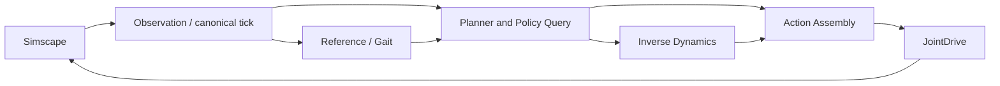

# 控制链的数据流边界

本轮在已验收的 OCS2/MEX 工程上拆分接口；不改变 OCP、求解器、Reference/Gait、JointDrive 或物理模型。不引入 MATLAB-native 控制器。CasADi 是后续原生数学内核的路线，本轮不替换现有内核。

## 当前完成状态

C++/MEX 已分离策略查询与逆动力学，旧 `step` 仍通过这两步实现并保留原 118 维输出。

**模型尚未接入拆分接口**：MATLAB 会话可执行代码，但 MCP 所需的 `model_read`、`model_edit`、`library.settingsLookup` 不在 MATLAB 路径上。`models/g1_walking.slx` 保持原样。不能把接口拆分称为已完成块图数据流重构。

## 下一步真实块图

这是待接入的结构图，不是已经部署的模型截图。

- `Planner and Policy Query`：reference 写入必须先于同 tick 查询；`query` 内仍含 MPC 更新调度、策略插值和配置启用时的状态反馈。尚未拆开 planner 与 MRT，不将其误称为纯插值块。
- `Inverse Dynamics`：单独接收被查询的策略；仍由原 Pinocchio 数学实现。不在此轮移植动力学。
- `Action Assembly`：现有 Simulink 逻辑保留，仅更改上游接口连接。输出关节目标、增益、前馈力矩。
- 用向量选择器将策略的状态、输入、模式、查询时间分别引到可观测信号；逆动力学输出单独记录。
- 保留 `PolicyAndID` 原输出顺序与端口，避免破坏 `run_walking` 和历史对照工具。

## MEX 数学与执行合同

| 命令 | 输入 | 输出 | 实际职责 |
|---|---|---|---|
| `reference` | 原 428 维参考包 | 无 | 提交当前时刻参考 |
| `query` | 原 74 维观测 | 95 维策略 | 调度优化 + 查询原 policy |
| `inverse_dynamics` | 当前查询产生的 95 维策略 | 23 维力矩 | 原逆动力学 |
| `step` | 原 74 维观测 | 原 118 维组合 | 兼容路径，顺序调用以上两步 |

95 维策略：1–58 状态，59–93 输入，94 模式，95 查询时间。
118 维组合：1–58 状态，59–93 输入，94–116 力矩，117 模式，118 查询时间。

逆动力学只接受当前 tick 原样返回的策略，拒绝篡改或过期包。一个 tick 必须完成动作生成后才能推进下一 tick。同 tick 查询和逆动力学重复调用幂等；只在动作完成时写一条完整 planner 日志。canonical period 0.002 s、query lead 0.005 s、原测量 STANCE 模式均保留。

## 数据流能力与工程边界

| 表达层 | 适合的表示 | 限制来自哪里 |
|---|---|---|
| 误差、增益、求和、限幅、总线 | 基本 Simulink 块 | 固定接口与采样时间需明确 |
| 步态切换、事件与复位 | 条件子系统 / Stateflow | 离散状态和事件优先级必须显式 |
| 策略查询到动作生成 | 独立计算块 + 信号 | 需要保存 policy 状态和调用顺序 |
| 动力学、代价、约束 | MATLAB/CasADi 生成的内核块 | 拆成标量块未必更可读，也不会自动加速 |
| SQP、QP、线搜索、候选选择 | 顶层流程可视化，内部矩阵代码 | 稀疏矩阵、循环、失败恢复和数据规模 |
| 初始化、编译、保存日志 | 工程脚本 | 属于运行生命周期，不是每周期控制信号 |

数据流能表达循环和条件，并非只能表示固定算术。实际边界是可读性、工具支持、动态数据结构、部署与执行效率，不是数学表达能力的绝对边界。MEX 拆成两个块只是显式化计算关系，不能宣称算法内部已改成数据流或已移植到 MATLAB。

## 验证状态

编译及有界离线检查结果保存在 `build/dataflow_refactor/`。验证使用历史真实 tick0 观测，不推进物理模型。检查拆分/组合接口、历史输出、重复调用及拒绝非法调用。

块图连接与模型编译尚未验证；本轮没有重跑 4.8 s，也没有新的视觉验收。恢复模型编辑工具后，再接入上述结构，进行模型检查及必要的运行回归。

本轮编译 PASS；历史真实 tick0 的拆分与组合输出严格相同，历史输出最大误差为 0。非法策略与未完成动作的 tick 推进均被拒绝，重复调用不重复记日志。摘要证据见 `dataflow_interface_checkpoint.json`。这是接口检查点，不是模型视觉重构验收。
