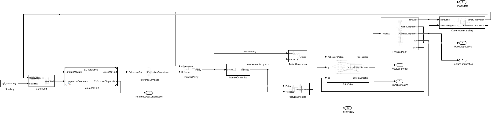
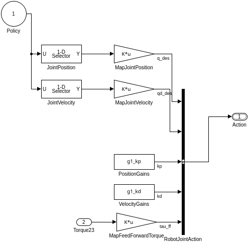

# 控制链的数据流边界

> 2026-10-18 更新：三个无状态转换 MEX 已替换为 `g1_planner` 的五个 MATLAB Function 块内代码，不再依赖独立转换 `.m` 文件；仅保留 `g1_ocp_mex`。旧 `PolicyQuery.m` / `InverseDynamics.m` System 适配类不参与当前模型。以下重构过程与检查点描述保留为历史；当前验证见 [原生 MATLAB 转换迁移](native_matlab_adapters.md)。

本轮在已验收的 OCS2/MEX 工程上显式拆分控制链，不改变 OCP、求解器、Reference/Gait、JointDrive 或物理模型。CasADi 仍是后续 MATLAB-native 数学内核的路线，本轮没有替换当前 Pinocchio/CppAD 内核。

## 打开模型看什么

执行 `open_project` 查看 `models/g1_walking.slx`；真正启动行走仍用 `out=run_walking`，由 runner 初始化、关闭共享 MEX。直接点模型 Run 不会替你初始化 MEX。

顶层按职责组织，展开子系统可以看到具体计算：

| 子系统 | 输入 → 输出 | 内部表示 |
|---|---|---|
| ObservationHandling | 真实物理状态/接触 → 原 74 维观测、ReferenceObservation | 原采样保持、Bus Selector、类型转换、Mux、原状态准备函数 |
| Command / ReferenceGait | 观测、指令 → 原参考与接触计划 | 保留原 Simulink 参考模型与步态逻辑 |
| ReferenceEnvelope | 参考总线 → 原 428 维接口包 | 原数据流打包 |
| PlannerPolicy | 观测、参考 → 95 维查询策略 | MATLAB System 调用 OCS2/MRT；输出后转为一维信号 |
| InverseDynamics | 查询策略 → 23 维前馈关节力矩 | 独立 MATLAB System 调用原数值内核 |
| ActionGeneration | 策略、前馈力矩 → RobotJointAction | Selector、关节映射 Gain、增益 Constant、Bus Creator |
| JointDrive | 动作、实际 q/qd → 实际关节力矩 | 原 PD、前馈、限幅与诊断 |
| PhysicalPlant | 实际力矩 → 真实物理状态 | 原 Simscape G1 |
| PolicyDiagnostics | 策略、前馈力矩 → 原 118 维诊断 | Demux/Mux；单独记录状态、输入、模式与查询时间 |

`PolicyDiagnostics` 只承担观测与兼容输出。它不再是动作生成的上游依赖。原七个输出端口的编号、名称、含义保留。

这里可以直接看到：策略中的关节位置/速度经过 23→29 关节映射，与增益和独立逆动力学输出组成动作总线。没有把动作生成藏回一个综合 MEX 块。

## 代码为什么仍存在

`matlab/+g1/PolicyQuery.m` 和 `InverseDynamics.m` 是两个 MATLAB System 适配类。它们只定义端口与 MEX 调用，没有第二份动力学或控制数学。模拟采用 **Interpreted execution**，不是新增可部署的控制器代码生成路线。

- PlannerPolicy 内仍包含 MPC 更新调度、求解器和 MRT 查询。MRT 是否使用反馈由原配置决定；不能把它称为纯插值块。
- 先发布该 tick 的 reference，再查询 policy。这两个有副作用的操作保留在同一适配调用中，避免靠图上位置猜测执行顺序。
- InverseDynamics 必须消费当前 policy；MEX 检查身份、有限性和重复调用。
- 初始化、缓存加载、编译、日志归档属于工程生命周期，保留在 runner / 脚本中。

这就是本轮的表达层次：**控制关系由图表达；状态化的求解器和复杂数值内核由代码实现；图上的模块可以独立观察。** 将数值内核封装成块，不代表已把其内部算法拆成基本数据流块，也不代表已经迁移为 MATLAB 数学。

## MEX 与执行合同

| 命令 | 输入 | 输出 | 实际职责 |
|---|---|---|---|
| `reference` | 原 428 维参考包 | 无 | 提交当前时刻参考 |
| `query` | 原 74 维观测 | 95 维策略 | 调度优化 + 查询原 policy |
| `inverse_dynamics` | 当前查询产生的 95 维策略 | 23 维力矩 | 原逆动力学 |
| `step` | 原 74 维观测 | 原 118 维组合 | 保留的兼容路径 |

95 维策略：1–58 状态，59–93 输入，94 模式，95 查询时间。
118 维组合：1–58 状态，59–93 输入，94–116 力矩，117 模式，118 查询时间。

逆动力学拒绝过期或被改动的策略。一个 tick 完成动作生成后才能推进下一 tick；重复调用幂等。只在动作完成时写一条完整 planner 日志。canonical period 0.002 s、query lead 0.005 s、原测量 STANCE 模式均保留。

## 能力边界

| 表达层 | 推荐形式 | 工程上的取舍 |
|---|---|---|
| 误差、增益、求和、限幅、总线 | 基本 Simulink 块 | 固定维度与采样时间清楚，便于逐信号检查 |
| 步态切换、事件与复位 | 条件子系统 / Stateflow | 显式定义离散状态与事件优先级 |
| 策略查询 → 逆动力学 → 动作 | 独立计算块 + 信号 | 保留 policy 状态与执行依赖 |
| 动力学、代价、约束 | MATLAB/CasADi 生成内核 | 公式与导数同源；无需为图而拆成大量标量块 |
| SQP、QP、线搜索、候选选择 | 顶层流程可视化，内部矩阵代码 | 稀疏矩阵、循环、动态数据规模与恢复流程影响可读性和效率 |
| 初始化、编译、保存日志 | 工程脚本 | 不属于每周期的控制信号 |

数据流可以表达条件、循环和状态；这些不是绝对能力禁区。实际边界是工具支持、可读性、动态数据结构、部署条件与执行效率。基本数据流块本身也由代码实现，数据流是一种组织与表达计算的方法，不意味着所有层次都不再需要代码。

## 验证与历史

接口检查点 `12dc21b` 的 tick0 独立验证与摘要保留在 `dataflow_interface_checkpoint.json`；其“模型未改”状态是当时的历史事实。

本轮最新模型验证见 `dataflow_model_checkpoint.json`。详细模型、回放脚本、日志及结果保存在忽略目录 `build/dataflow_refactor/`。控制回放使用已验收 4.8 s 行走的真实观测和参考，验证重构后的控制计算；它不推进 Simscape，不能冒充一轮新的真实物理行走或新的人工视觉验收。

最终重放覆盖 2401 个控制 tick、289 次 MPC 更新。策略/逆动力学及关节动作最大绝对误差均为 0；观测前 72 项、实际接触标志、模式、canonical time 和兼容诊断组装严格一致。控制链编译与结构检查通过；保留原有 4 个传感器 world-frame 警告。PhysicalPlant 的 50 个内部 system XML 与 JointDrive 的内部 XML 逐字节不变，参考模型、数据字典与任务参数也未改变（参数文本与 Git 的比较考虑已有 CRLF/LF 差别）。

MEX 初始化约 2.04 s，控制重放约 29.76 s；这些是离线重放耗时，不是实时性能声明。没有新的物理行走或视觉 PASS。
